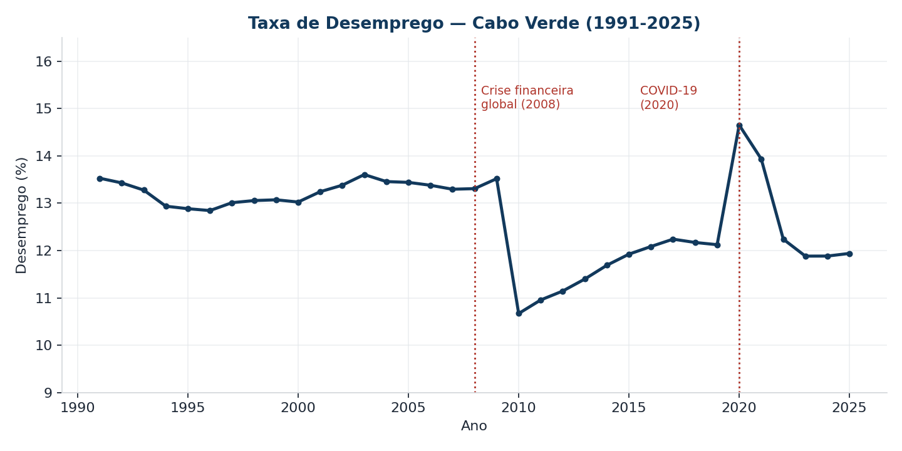
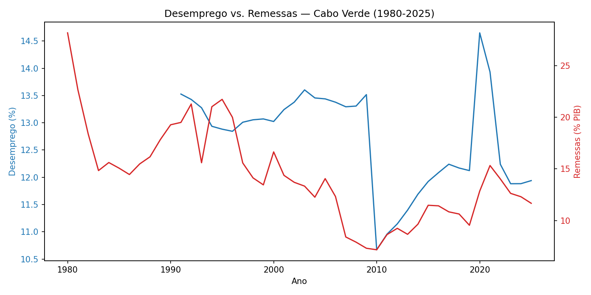
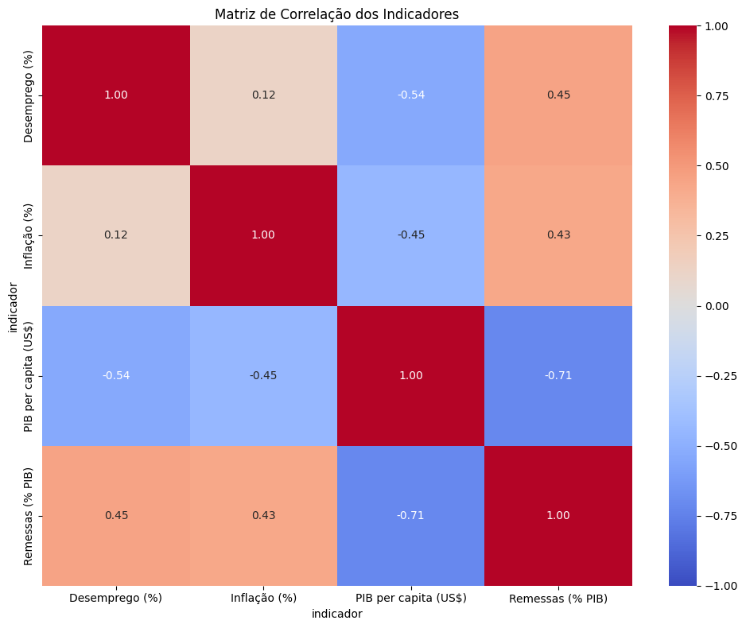
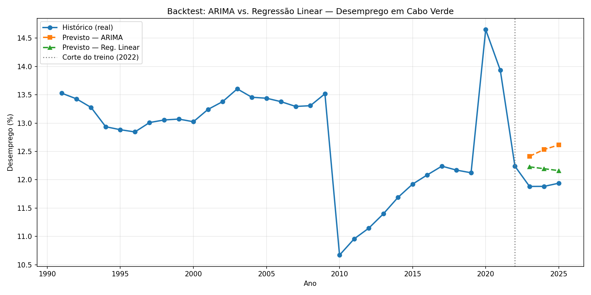

## Labour Market and Diaspora Remittances in Cabo Verde (1980–2025)

---

## 1. Objective

Analyse the evolution of the labour market in Cabo Verde and its relationship with diaspora remittances, answering 5 business questions defined at the beginning of the project.

## 2. Data sources

| Source | Indicators | Period |
|---|---|---|
| World Bank Open Data (World Bank Combined Indicators for Cabo Verde) | Unemployment (`SL.UEM.TOTL.ZS`), Remittances % of GDP (`BX.TRF.PWKR.DT.GD.ZS`), GDP per capita (`NY.GDP.PCAP.CD`), Inflation (`FP.CPI.TOTL.ZG`) | 1980–2025 |

The original file had 62,983 rows (2,758 indicators, all countries); after filtering the 4 indicators and removing duplicates (an error in the file itself, not in the collection process), **169 tidy rows** remained.

## 3. Methodology

| Phase | Tool | What was done |
|---|---|---|
| 1 | Excel (Power Query) | Filtering of the 4 indicators, duplicate removal, tidy table `Year \| Indicator \| Value`, Pivot Table and 2 charts |
| 2 | SQL (SQLite) | Normalized schema (`indicators` + `annual_data`), populated via `INSERT...SELECT` with `JOIN`; queries for trend evolution, year-over-year change (`LAG`) and series comparison |
| 3 | Python (pandas, statsmodels, scikit-learn) | Exploratory analysis, correlation between indicators, **backtest** of 2 forecasting models (training through 2022, testing in 2023–2025) |
| 4 | Streamlit (Dashboard) | 3-page dashboard (Overview, Time Evolution, Insights), DAX measures for annual variation and moving average |

## 4. Key results

### 4.1 Unemployment trend (2000–2025)
Unemployment remained stable at around **13%** throughout the 2000s. In **2010**, it fell sharply (10.67%), a delayed effect of the global financial crisis of 2008–09. It then declined gradually until a pre-pandemic low of **12.1%** in 2019, surged to **14.65%** in 2020 (COVID-19), and has since recovered to **11.9%** in 2025 — the lowest level in the series, alongside 1994–1996.



### 4.2 Relationship between remittances and unemployment
The correlation between the two series is **positive but weak (+0.45)** — it contradicts the intuition that more remittances ease local unemployment. Remittances appear to respond mainly to economic shocks in the countries of origin of the diaspora (especially Europe), not to the domestic labour market. The correlation between unemployment and **GDP per capita** is stronger and in the expected direction: **-0.54**.





### 4.3 Gender and territory disparity
**Not answered.** This question required disaggregation by sex and area (urban/rural) from INE data, which was not collected during the project. It remains recorded as a limitation rather than an analysis failure — collecting this data is the natural next step for a second iteration of this project.

### 4.4 Trend and estimate for 2026–2028
Two models were tested: **Linear Regression** and **ARIMA(1,1,1)**. Instead of choosing based on the “name,” a **backtest** was performed: training on data up to 2022, forecasting for 2023–2025 (years already known), and comparing with reality.

| Model | MAE | MAPE | Accuracy |
|---|---|---|---|
| Linear Regression | **0.293** | 2.46% | 97.54% |
| ARIMA(1,1,1) | 0.620 | 5.21% | 94.79% |

Linear Regression had lower error — ARIMA, by giving more weight to the recent shock of 2020–2022, overestimated the continuation of the decline. Using Linear Regression, the estimate for 2026–2028 is unemployment remaining stable between **11.9% and 12.1%**.



### 4.5 Recommendation
Because the remittances–unemployment relationship is weak and sometimes counterintuitive, **remittances should not be used as a lever for youth employment policy**. GDP per capita shows a stronger and more actionable negative correlation — growth and direct investment policies have a clearer link to reducing unemployment than dependence on the diaspora.

## 5. Visualisations produced

- Line chart: unemployment 1991–2025 (Excel and Python)
- Dual-axis chart: unemployment vs. remittances 1980–2025 (Excel and Python)
- Backtest chart: actual history + ARIMA forecast + Linear Regression forecast, with a cut-off line in 2022
- Power BI dashboard: 3 pages (Overview, Temporal Evolution with year slicer, Insights)

## 6. Limitations

- Short series (35–46 annual points) — any forecasting model has a considerable margin of error.
- Correlation does not imply causation; the figures in 4.1–4.2 describe patterns, not mechanisms.
- World Bank unemployment is an **ILO-modeled estimate**, which may differ from the official INE value for the same year.
- Without gender/territory disaggregation (objective 3), the analysis remains limited to the national aggregate level.

## 7. Conclusion

The project answered 4 of the 5 questions defined at the beginning, with quantitative evidence for each answer (SQL queries, Python correlation tests, forecasting model backtests). The most relevant — and most honest — result was discovering that the more "advanced" model (ARIMA) was not the most accurate in this case: the backtest validation showed that simple Linear Regression had less than half the error of ARIMA for this dataset. This is arguably the most important methodological conclusion of the project: **choose the model based on what is tested, not on what appears more sophisticated**.

## 8. How to reproduce this project

```
cabo-verde-mercado-trabalho/
├── README.md ← this file
├── data/
│   ├── raw/indicators_cpv.csv
│   └── processed/cabo_verde_indicadores_limpo.csv
├── excel/cabo_verde_indicadores.xlsx
├── sql/schema.sql, queries.sql, cabo_verde.db
├── python/analise_exploratoria.ipynb
├── powerbi/dashboard.pbix, tema_cabo_verde.json
```

---
*Author: Rodrigo Hendrick Monteiro Santos Fortes ·*